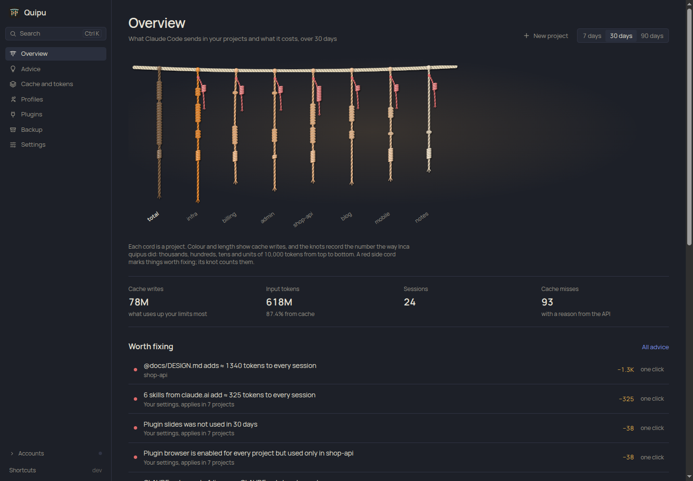
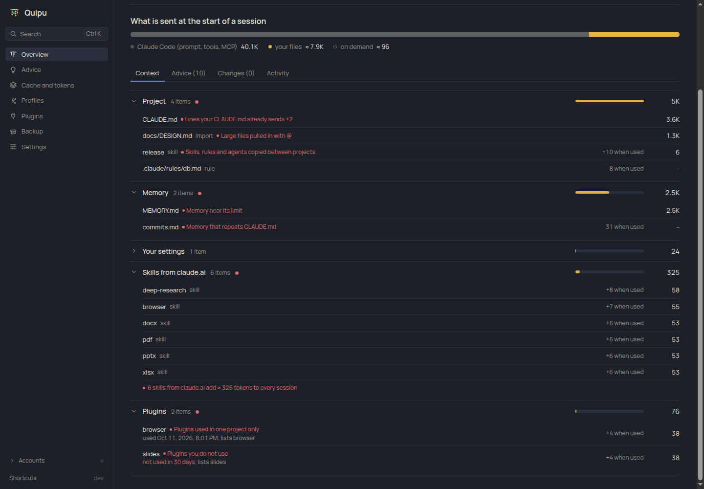
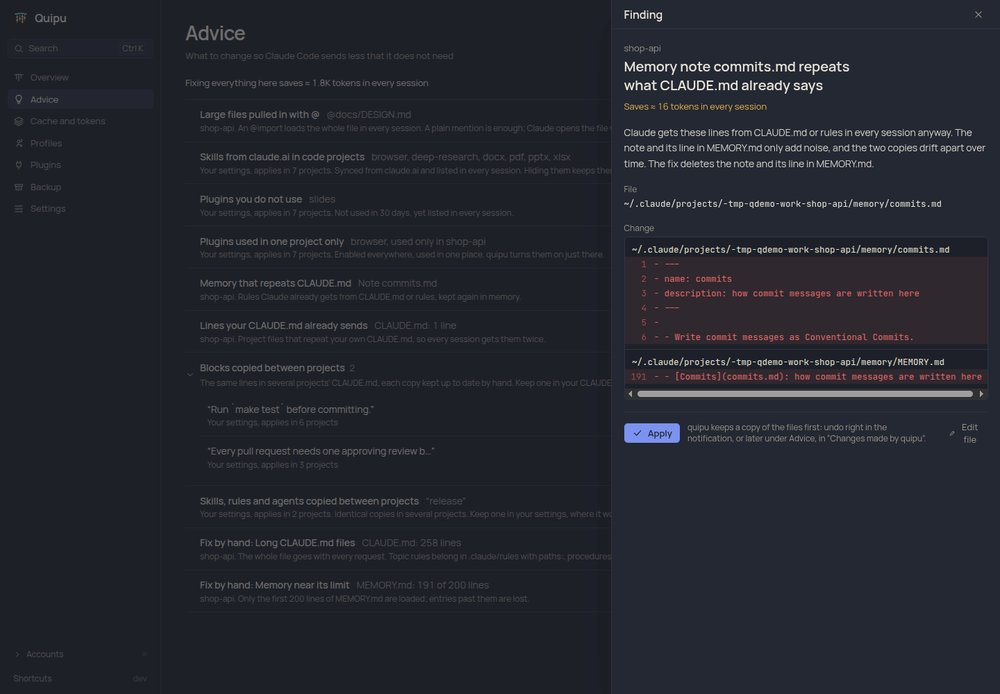
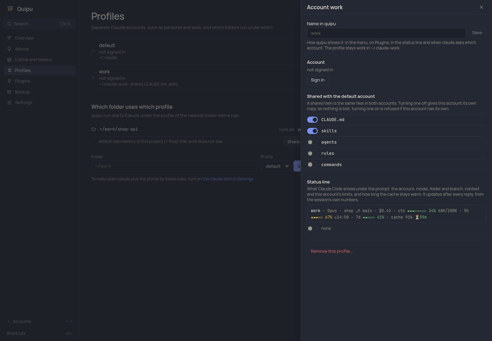
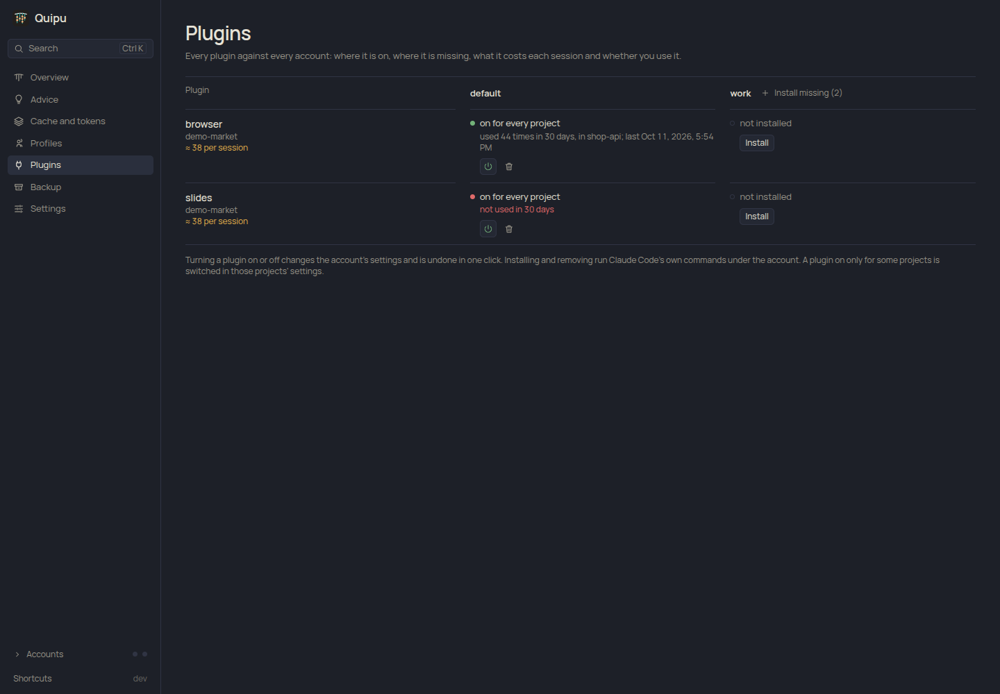
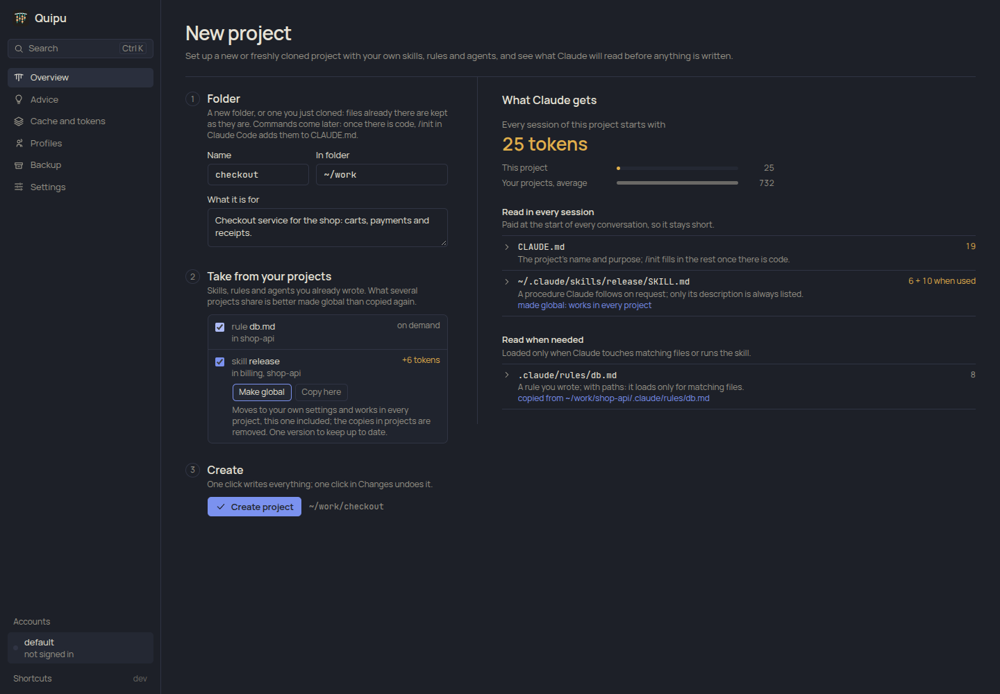

# Quipu

**A local app for Claude Code: see what it reads in each of your projects and what that costs, fix
it in one click, and keep several accounts side by side.**

Quipu is a desktop window and a command-line tool for people who work in Claude Code every day.
It is named after the Inca quipu, knotted cords that kept a state's accounts; here each cord is a
project and its knots count tokens.

Every Claude Code session starts by sending your `CLAUDE.md` files, imports, rules, skill
descriptions, memory and plugins, before you have typed anything. That weight is paid again in
every session, and it grows quietly: a design doc pulled in with `@`, a skill copied into five
projects, a plugin nobody uses. Quipu reads your Claude Code setup and transcripts locally, shows
where the tokens go, and turns what it finds into concrete edits you can review and undo. It also
runs your personal and work accounts side by side, with their plugins and a status line that shows
each account's limits.



Everything runs on your machine. Quipu reads no credentials, sends nothing about you anywhere, and
changes a file only when you click Apply, keeping a copy so the change can be undone. The one
request it makes is asking GitHub for the newest release: when you click the check next to the
version, or once a day if you turn that on.

## What it does

**Shows what is loaded and what it costs.** For every project: what goes into each session,
grouped by where it comes from (the project, its memory, your settings, claude.ai, plugins), with
each file, skill or plugin once: what it costs in every session and what it adds when used. Files
with something to fix say what. Cache writes, hit rate and the miss reasons the API reports, per
project and per day.



**Finds what is worth fixing, with a diff for each.**

| Finding | Fix |
|---|---|
| A large file `@imported` into `CLAUDE.md`, paid in every session | mention it in plain text so Claude opens it when needed |
| Skills synced from claude.ai listed in every code project | hide them from the model; they stay available as `/name` |
| `CLAUDE.md` longer than 200 lines, `MEMORY.md` near its load limit | where to trim |
| A project repeating lines your own `CLAUDE.md` already sends | remove the repeat |
| Memory repeating what `CLAUDE.md` or rules already say | remove it from memory, or delete the note |
| The same `CLAUDE.md` block, skill, rule or agent copied into several projects | keep one, in your own settings |
| A plugin unused for 30 days, or enabled everywhere but used in one project | turn it off, or enable it only there |
| A skill of yours listed in every session but not invoked for 30 days | hide it from Claude; it still works as `/name` |

Findings are grouped by kind, with the tokens all of them would save on top. Each fix is shown as
a diff over every file it touches. Apply writes them all or none; every change is journaled and
undone in one click, alone or with the rest of its batch.



**Edits with the cost in view.** An editor for `CLAUDE.md`, rules and skills that shows the
token cost as you type.

**Several accounts, picked by folder.** Keep personal and work Claude subscriptions side by side
(`CLAUDE_CONFIG_DIR` profiles). Plain `claude` picks the account by folder through an optional
shim, for bash, zsh and fish alike (an IDE terminal often runs a different shell than your
login one). In a folder without a rule it asks which account to use and offers to remember the
answer for the whole git repository.

Each account is set up in one panel: the name Quipu shows it by, its sign-in, which of
`CLAUDE.md`, skills, agents, rules and commands it shares with your main account, and its status
line. A new account can start like your main one, with its status line and plugins, in the same
step. A project that moves to another account can keep its memory: Quipu points both accounts at
one memory folder through Claude Code's own `autoMemoryDirectory` setting, so Claude remembers what
it learned about the project under either. `quipu doctor` checks the whole setup.



**Plugins against accounts.** Plugins are installed per account, so one you rely on can be missing
from another. The Plugins page puts every plugin against every account: where it is on, where it
is missing, what it lists in each session, and whether you used it in the last 30 days. Turn it
off or on (undoable), remove it, or install it into an account that lacks it, one by one or all at
once; Quipu adds the marketplace from where your other account got it and runs Claude Code's own
`claude plugin install` under that account.



**A status line for the account you are in.** Turn it on per account and Claude Code shows, under
the prompt:

```text
work max 5× · Opus 5.5 xhigh · shop ⎇ main · $0.42 · ctx ▰▰▰▱▱▱▱▱ 34% 68K/200K · 5h ▰▰▰▱▱ 67% ↻14:50 · 7d ▰▰▱▱▱ 41% ↻Tue 19:00 · cache 91% ⏳4m
```

The account and the tier of its plan that sets the limits (max 5×, team standard), the model and
its effort, folder and branch, session cost, context used (as a bar and in tokens), the 5-hour and
weekly limits with their reset, the cache hit ratio and how long the cache stays warm; past that,
the next message pays for the whole context again. Fast mode, the branch's PR with its review and
the cause of a recent cache miss appear when they apply. Colours go green, yellow and red as things
fill. Everything comes from what Claude Code passes the status line for that session, so each
account sees its own numbers; Quipu reads no login and makes no requests for it. A status line it
replaces is kept aside and comes back when you turn Quipu's off.

**Starts new projects from your own work.** Set up a new or freshly cloned folder with skills,
rules and agents from your other projects. What several projects already share is offered as
global instead of copied again, and you see what Claude will read before anything is written.
Quipu adds no templates or conventions of its own.



**Also:** backup and restore of the setup of every account, even one without a session yet, as an
archive or into your own git repository, with a scan for credentials first and the memory of the
projects you choose left out; live sessions with Remote Control links; a first
run that shows its progress while it reads your history, then collects in the background; English
and Ukrainian; light and dark themes; updates from the window, checked against the release's
checksums, then a restart in place; keyboard first (`Ctrl K`, `G` then a letter, `?` for help).

## Install

```sh
curl -fsSL https://raw.githubusercontent.com/axvilab/quipu/main/install.sh | sh
quipu install    # start at login and add Quipu to the application menu (undo: quipu uninstall)
quipu ui         # open the Quipu window
```

The script puts `quipu` and its window `quipu-app` into `~/.local/bin` (on macOS the window is
`~/Applications/Quipu.app`) after checking their checksums; no root needed. It runs on Linux
(glibc, x86_64 and arm64) and macOS (Intel and Apple Silicon). On Linux the window needs
WebKitGTK 4.1, which desktop distributions usually have (`libwebkit2gtk-4.1-0` on Debian and
Ubuntu); without it, or with `quipu ui --browser`, Quipu opens in the browser at
http://quipu.localhost:47800.

### Try it without touching your setup

```sh
quipu demo /tmp/qdemo          # a fake home with projects, transcripts and things to fix
HOME=/tmp/qdemo quipu ui
```

## Command line

The window is the main way in, but everything works from a terminal too:

```text
quipu map [path]       what Claude Code loads for a project and how much it weighs
quipu cache            cache hit rate per project or day, and why the cache missed
quipu advise [path]    findings for a project, each with its diff
quipu new <folder>     set up a new or freshly cloned project from your own skills and rules
quipu profile …        accounts, folder rules, shared memory (profile memory) and the claude shim
quipu run              start claude under the profile of the current folder
quipu statusline       the status line Claude Code runs (turn it on per account in the window)
quipu doctor           check Claude Code, profiles, the shim and quipu itself
quipu backup           save the setup of every profile; quipu restore brings it back
quipu daemon           collect transcripts in the background (quipu install sets this up)
```

## How it works

Claude Code deletes transcripts after 30 days by default. Quipu's collector copies the usage
from them (tokens, cache, models, plugins; not the conversation text) into Parquet files in
`~/.local/share/quipu` (`~/Library/Application Support/quipu` on macOS) and queries them with an
embedded DuckDB. Instructions are read from the files themselves: `CLAUDE.md` and its imports,
rules, skills, agents, memory and plugin settings, for every profile.

Quipu works with Claude Code only through what it supports: config directories, settings files,
files in `.claude/`, plugins and hooks. It never edits `~/.claude.json` and never reads login
tokens. Token counts for your files are estimates; the totals come from what the API reported.

Design and decisions: [docs/DESIGN.md](docs/DESIGN.md) and [docs/adr](docs/adr/README.md).

## Development

Go and Node run only in Docker, so nothing is installed on your machine:

```sh
make test         # Go tests
make web          # build the Svelte frontend
make build        # frontend, bin/quipu and bin/quipu-app (the window)
make web-dev      # Vite dev server with hot reload; run `quipu ui --port 47801` beside it
make clean-cache  # remove the Docker volumes with caches and the window's build image
```

Try changes on a fake home (`quipu demo /tmp/qdemo`), never on your real `~/.claude`.

## License

[MIT](LICENSE)
